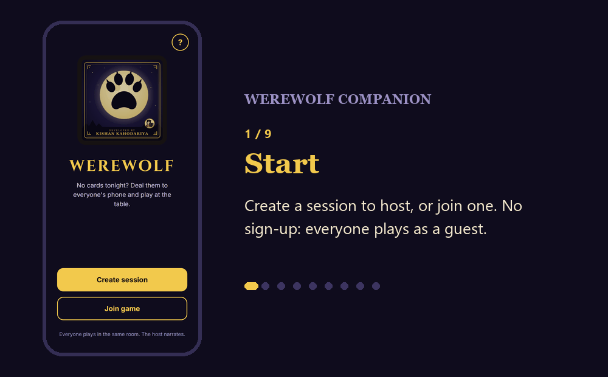
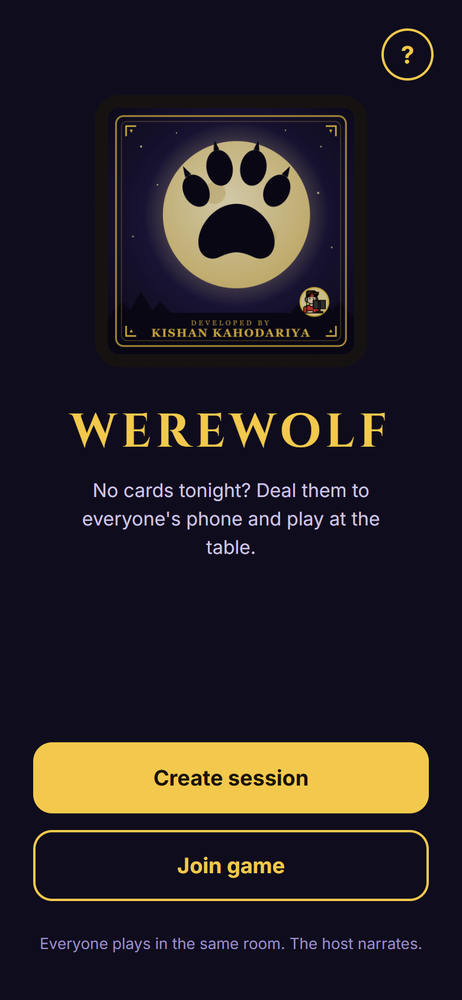
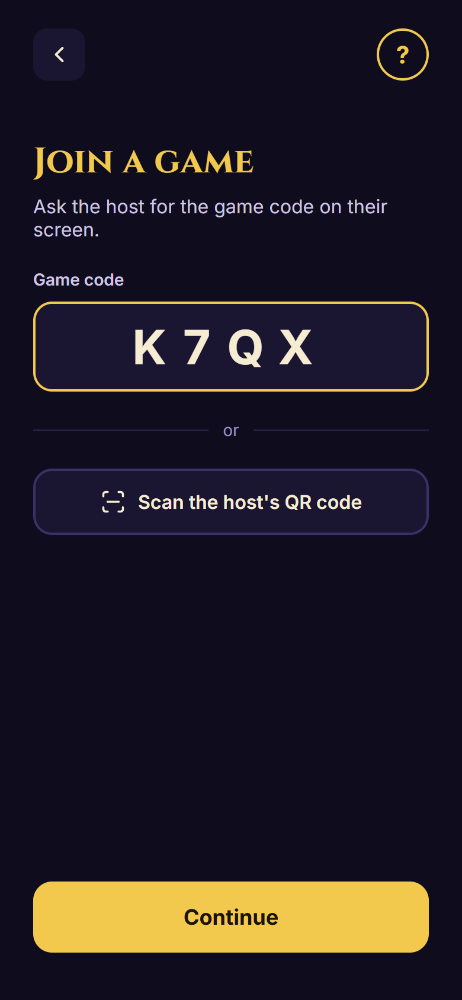
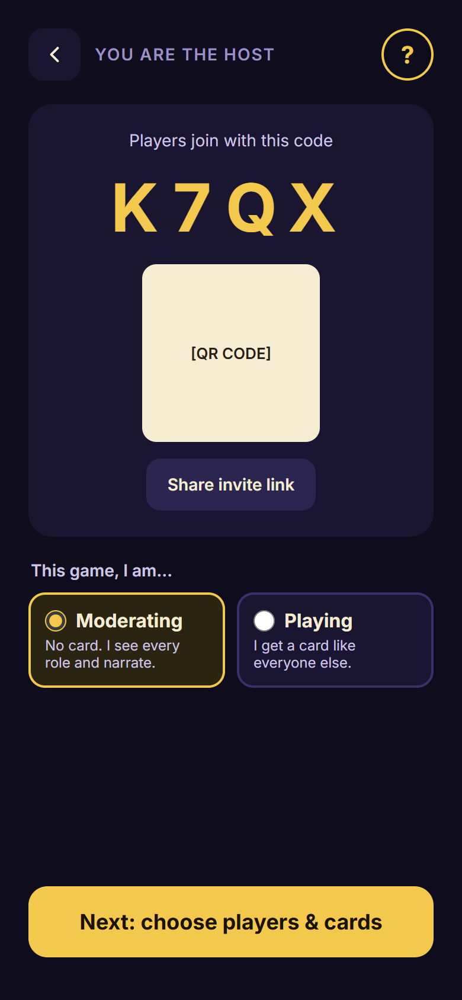
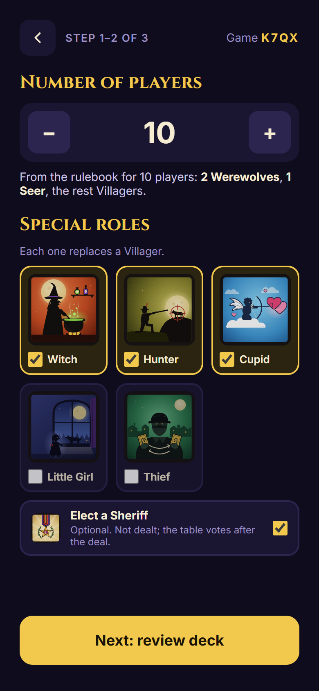
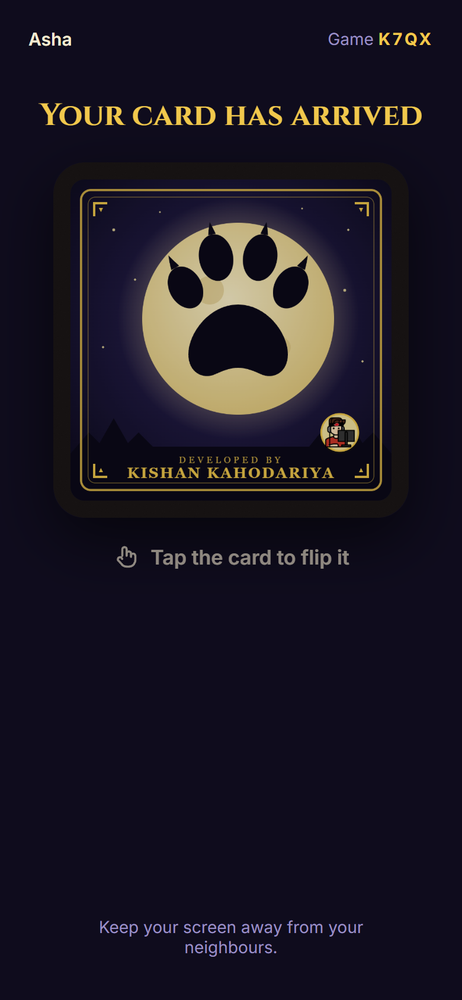
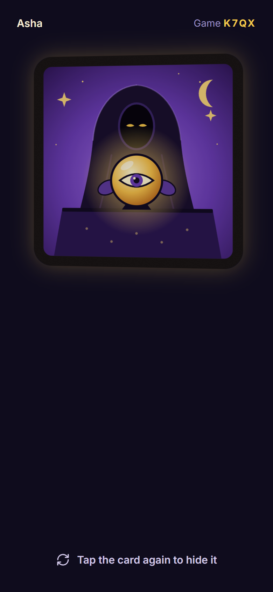
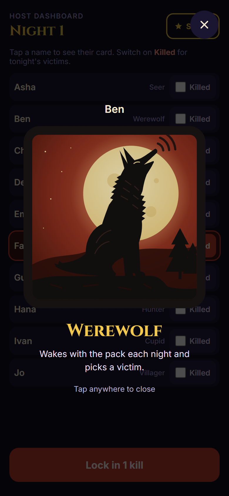
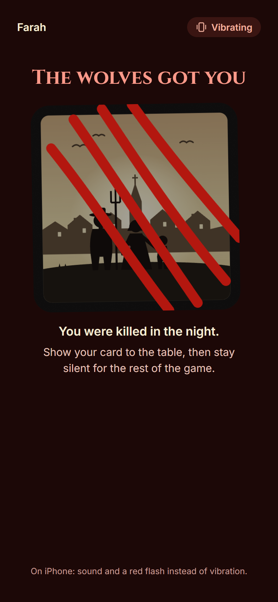
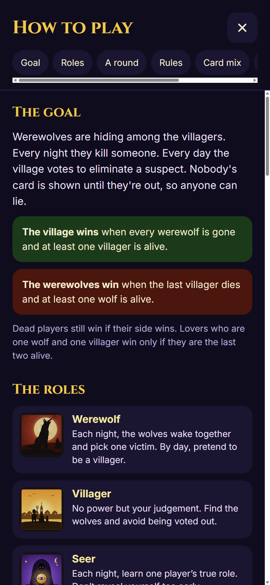

<p align="center">
  
</p>

<p align="center">
  
  
  
  
  
  
  
  
  
</p>

# Werewolf Companion

A phone app for playing Werewolf in the same room when nobody brought the cards.

The app deals a secret role card to every player's phone. The host narrates out loud,
just as with the physical game, and uses the app to see who has which card and to
reveal each night's victims. There is no chat, no timers and no in-app voting: the game
still happens around the table.

It runs in the mobile browser on Android and iPhone. Players join from a link or a QR
code, as guests, with nothing to install and no account to make.

> **Status:** design phase. The screens above are mockups. The game flow, rules and
> architecture are written up, and the app itself hasn't been built yet.

## How a game works

1. **Host creates a session.** A 4-letter code and a QR code appear. The host chooses
   to moderate or to play.
2. **Players join** by scanning the QR code or typing the code, then enter a name and
   tap Ready.
3. **Host sets up the deck:** player count, then special roles. Card counts follow the
   rulebook's table.
4. **Cards are dealt.** Each card lands face down on its player's phone. A tap flips it
   to show the role, and another tap hides it.
5. **Sheriff (optional).** The table votes out loud, and the host gives the Sheriff
   card to the winner.
6. **Night.** The host marks the wolves' victims on the dashboard and locks them in.
7. **Dawn.** The host taps Reveal. Each victim's phone vibrates and plays a werewolf
   attack over their card.
8. **Game over.** Keep the host or pass hosting on, and deal again with the same lobby.

A **?** button on the Start, Join and host screens opens a scrollable guide with the
goal, roles, rules and card mix.

## Roles

<p>
  
  
  
  
  
  
  
  
  
</p>

Werewolf, Villager, Seer, Witch, Hunter, Cupid, Little Girl and Thief, plus the
Sheriff, who is elected rather than dealt. Each role's power is in
[design/rules/02-roles.md](design/rules/02-roles.md).

## Tech stack

| Part | Choice |
|---|---|
| App | Next.js (React + TypeScript), exported as a static site |
| Back end | Firebase Realtime Database for rooms, cards and reveals |
| Players | Firebase Anonymous Auth: guests only, no login screen |
| Hosting | Firebase Hosting |
| Art | SVG cards, CSS animations for the flip and the attack |

There's no game server to run. Every phone runs the same web app and they stay in sync
through one shared room record in the database. Game logic and card data are kept apart
from the UI, so a native Unity version for the app stores can reuse them later.

## Project layout

```
assets/2d assets/     card art (SVG, plus the card back as PNG)
assets/screenshots/   the mockup screenshots used in this README
design/               app flow and architecture notes
design/rules/         rulebook: overview, roles, card mix, game flow, rulings
production/qa/        test evidence
```

## Design docs

- [design/companion-flow.md](design/companion-flow.md): the app flow, decisions, tech
  stack and open questions. Start here.
- [design/companion-architecture.md](design/companion-architecture.md): rooms, joining,
  dealing and reveal over Firebase, with the join link and QR code.
- [design/rules/](design/rules/): the rules, written from the physical game's booklet.

## Credits

Designed and developed by Kishan Kahodariya.
